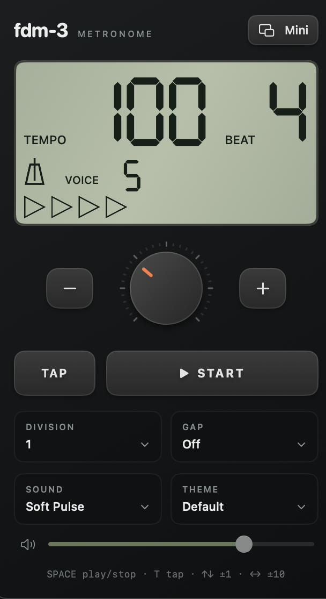

# fdm-3

A compact macOS metronome inspired by the Korg KDM-3.

30–252 BPM, tap tempo, subdivisions, five voices, IDE/Vim themes, and an always-on-top mini mode.



## Build and run

Requires macOS 13+ and Apple Command Line Tools with Swift 5.9+. Full Xcode is optional.

Install the tools once:

```sh
xcode-select --install
```

Then run from the project folder:

```sh
bash scripts/build.sh
open dist/fdm-3.app
```

## Controls

| Control | Action |
| --- | --- |
| Left dial / click BPM | Adjust tempo / type a value |
| ▲ / ▼ | Change beats: No accent, then 2–9 |
| Space | Start / stop |
| T | Tap tempo |
| ↑ / ↓ | Tempo ±1 BPM |
| Shift + ↑ / ↓ | Increase / decrease beats |
| ← / → | Tempo ±10 BPM |
| Tab or &#92; | Toggle mini mode |
| Speaker button / M | Mute / restore previous volume |

Use the gear button for Subdivision, Gap, Sound, Theme, and volume. Tap tempo is in the header; the four round buttons beside the wheel control beats, mute, and Start/Stop. Click the BPM digits to edit them in place. Return or clicking away applies the value; Escape cancels. Only digits are accepted (up to three); an empty field restores the previous tempo; values are limited to 30–252 BPM. The main window and widget share the same LCD layout: tempo, beat count, pendulum, beat indicators, gap status, and subdivision notes. Voice is no longer shown on either display. Themes group LCD colors by tempo, beats, and supporting symbols, with neutral labels and matching buttons. Active Start/Stop uses the theme's playback color. Settings are remembered. Closing the main window quits the app.

## Gap practice

Play 1, 2, or 4 audible bars, then one silent bar. **Random** chooses a fresh audible run length each cycle, with equal probability. **Off** plays continuously.

No accent uses four-beat bars for gap practice. The LCD shows **GAP** during silence.

---

Homebrew installation is not published yet. See [CHANGELOG.md](CHANGELOG.md) for version history.
