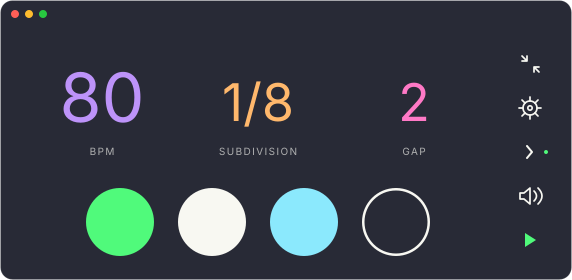

# fdm

A compact macOS metronome with round beat lights, tap tempo, subdivisions, gap practice, five sounds, and IDE/Vim themes.




## Build and run

Requires macOS 13+ and Apple Command Line Tools with Swift 5.9+. Full Xcode is optional.

```sh
xcode-select --install
bash scripts/build.sh
open dist/fdm.app
```

## Controls

- **BPM / subdivision / gap:** drag up/down. Gap cycles Off, 1, 2, 4, Random audible bars. Double-click BPM for optional numeric entry.
- **Right column:** Widget, Settings, Accent, Mute, and Start/Stop.
- **Settings:** Beats (1–7), Gap Length (1–8 bars), Sound, Theme, volume, and Tap.
- **Space:** Start/Stop. **T:** tap. **M:** mute.
- **↑/↓:** tempo ±1. **←/→:** tempo ±10. **Shift + ↑/↓:** beats. **Shift + ←/→:** gap. Shift shortcuts work only in the main window.
- **Tab or &#92;:** switch to the floating widget.

Completed beats stay filled. With Accent enabled, the first indicator uses the Play accent and blends into the current-beat color while active; other active beats use the current-beat color. Beat-count and accent edits appear immediately; their audio changes follow the boundaries below. The widget shows read-only BPM and beat progress, with a flat expand control. The always-visible speaker button toggles mute; it shows a slash when muted. Silent gap bars keep the normal theme colors, with current and completed beats half-filled: upper half for the accented first beat, lower half otherwise.

Tempo, sound, accent, and subdivision changes take effect on the next beat. Beats per bar and gap changes take effect on the next bar, without restarting playback.

Subdivision includes **1/1** (one click every four beats) and **1/2** (every two), followed by 1/4, 1/8, triplets, and 1/16. Beat lights always advance on every beat.

## Gap practice

Play 1, 2, or 4 audible bars, then 1–8 silent bars. **Random** chooses a fresh audible run length each cycle. The Gap value always shows the selected interval; the dot row shows progress through audible and silent bars.

When Gap is on, small neutral dots below the beats show the bar sequence: current brightest, audible softer, silent faint. Random keeps its audible run hidden, then shows progress through the silent bars.

Existing beat-based gap lengths round up to whole bars. Accent is independent of meter. Closing the main window quits the app.

The Dock icon follows the selected theme; Finder uses Default. Homebrew installation is not published yet. See [CHANGELOG.md](CHANGELOG.md) and [theme palette sources](docs/themes.md).

