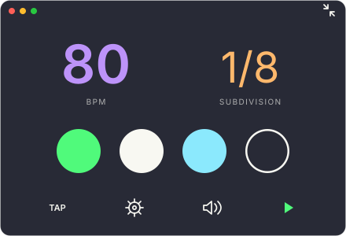

# fdm-3

A compact macOS metronome with round beat lights, tap tempo, subdivisions, gap practice, five sounds, and IDE/Vim themes.



## Build and run

Requires macOS 13+ and Apple Command Line Tools with Swift 5.9+. Full Xcode is optional.

```sh
xcode-select --install
bash scripts/build.sh
open dist/fdm-3.app
```

## Controls

- **BPM:** drag up/down to adjust (30–252). Double-click for optional numeric entry.
- **Subdivision:** drag up/down through quarter notes, eighths, triplets, and sixteenths.
- **Settings:** Beats (No Accent, then 2–9), Gap, Sound, Theme, and volume.
- **Space:** Start/Stop. **T:** tap. **M:** mute.
- **↑/↓:** tempo ±1. **←/→:** tempo ±10. **Shift + ↑/↓:** beats.
- **Tab or &#92;:** switch to the floating widget.

Completed beats stay filled; the current beat uses the theme's highlight. No Accent flashes one light per beat. Beat lights show progress and do not change the beat count when dragged.

The main window shows subdivision or GAP; the single-row widget shows BPM with its unit and beat progress. Speaker and Start/Stop use flat styling, with the playback accent on Start/Stop. Closing the main window quits the app.

## Gap practice

Play 1, 2, or 4 audible bars, then one silent bar. **Random** chooses a fresh audible run length each cycle with equal probability. No Accent uses four-beat bars.

The Dock icon follows the selected theme; Finder uses Default. Both use the same padded artwork.

Homebrew installation is not published yet. See [CHANGELOG.md](CHANGELOG.md).
